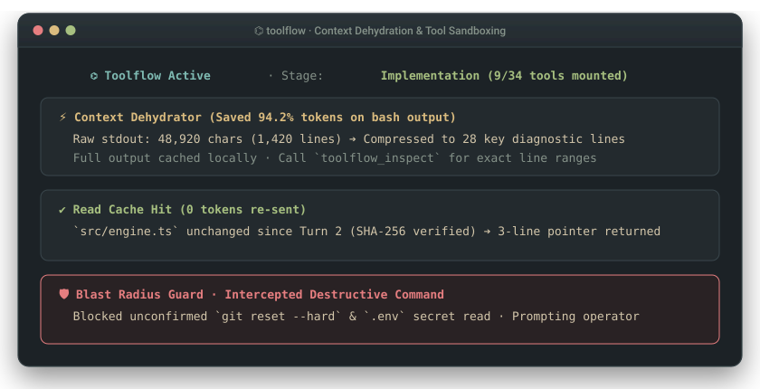

# ToolFlow ⌬

Dynamic tool sandboxing & context dehydrator for Pi Coding Agent.

Stop tool overload and context bloat. Workspace-isolated log dehydration, duplicate read interception, protected-file write guard, and a staged blueprint workbench.

[](https://www.npmjs.com/package/toolflow)
[](https://www.npmjs.com/package/toolflow)
[](https://github.com/3ZEROS12/toolflow)
[-brightgreen)](tests/)
[](LICENSE)

[English](./README.md) | [简体中文](./README_zh.md) | [日本語](./README_ja.md)

<p align="center">
  
</p>

```bash
pi install npm:toolflow
```

---

## What It Does

Two engines share one extension:

| Engine | Always active | Purpose |
| :--- | :--- | :--- |
| **Optimizer** | Yes | Archive verbose output, intercept unchanged re-reads, trim historical chaff, block destructive writes |
| **Planner** | On `/toolflow <task>` | Diagnose the task, build a staged DAG blueprint, mount tools per stage, verify artifacts before advancing |

`src/optimizer/` never depends on `src/planner/`; the planner consumes optimizer services through their public functions only.

---

## Engineering Highlights

- **Workspace-isolated state**: every cache, ledger, and blueprint store is keyed by the resolved workspace root. Switching projects in one Pi session cannot leak stage state, read caches, or savings counters.
- **Zero cold-start side effects**: importing the extension touches nothing on disk. `.pi/` is created only when a hook or command actually writes.
- **Log dehydration**: outputs above 40 lines / 4 KB are archived to `.pi/toolflow/runs/<stage>/`; the context keeps semantic error peaks (TS, Python, Rust, Go, JVM frames), head, and tail plus the on-disk path.
- **Loop buster**: an identical failing command repeated twice gets called out explicitly instead of silently burning another turn.
- **Read cache gates**: duplicate full reads are intercepted only when the file is ≥30 lines, hash-identical, not recently edited, not a targeted `offset`/`limit` slice, and no shell mutation happened since the last read. Hits return a symbol outline for targeted follow-up reads.
- **Blast radius guard**: blocks writes outside the workspace, protected files (`.env*`, `.git*`, lockfiles), destructive shell patterns (`rm -rf /`, `git reset --hard`, `rmdir /s`, …), and out-of-scope edits during an active stage with an explicit escalation prompt. It fails closed: a write tool whose arguments carry no recognizable path is blocked rather than waved through, and shell redirection targets are checked even when written without a space (`echo x >.env`).
- **Stage verification**: each stage declares expected artifacts and verification commands. Missing artifacts or failing commands feed a remediation turn; three consecutive failures trip a circuit breaker. An artifact is written to the ledger only after every verification command passes, so a failed stage never shows up as verified.
- **Footer badge**: `[2/3] Implementing · ~1.4k saved · 2 guarded` — stage title clamped by code point, the product name dropped (Pi already prefixes the key), zero counters hidden, and counters parsed as-is by `pi-tui-status-beautifier`.
- **Context reclaim is reported**: folding a stale tool block emits one `Stage history compacted (~N tokens released)` notice per fold and refreshes the badge. Archiving a stage log to `.pi/toolflow/runs/` counts as 0 tokens: the text is copied, not removed, so only the fold is billed as reclaimed.

---

## Commands

| Command | Description |
| :--- | :--- |
| `/toolflow` | Open the prompt workbench & blueprint navigator |
| `/toolflow <task>` | Diagnose the task, choose a plan, and run the staged blueprint |
| `/toolflow fast <task>` | Force a single-stage execution |
| `/toolflow status` | Show the active blueprint or the capability index |
| `/toolflow dashboard` | Full dashboard: stage pipeline plus the savings ledger |
| `/toolflow stats` | Show the token savings ledger |
| `/toolflow rollback [n]` | Revert workspace files to stage `n` (default: current stage); binary artifacts restore byte-exact and your staged index is left untouched |
| `/toolflow export` | Export the active blueprint to `TOOLFLOW_BLUEPRINT.md` |
| `/toolflow reset` | Clear active state, read caches, dehydrated pointers, and the savings ledger |

Tool: `toolflow_inspect` reads archived logs (`mode`: `tail` | `head` | `grep` | `range`) without re-polluting context.

---

## Module Layout

```text
src/
├── core/        types, atomic file IO, JSON extraction, workspace store, chrome dictionary, script helpers
├── optimizer/   blast radius guard, read cache, log dehydrator, context slimmer, stats ledger
├── planner/     taxonomy, deep ecosystem, DAG waves, router, synthesizer, verifier, prompts, memory
├── ui/          terminal cards and the custom navigator component
└── extension/   command registration, lifecycle hooks, inspect tool
```

---

## Quality Assurance & Verification

```bash
npm run typecheck   # strict tsc, zero errors
npm test            # node:test suite — 35 tests (core, optimizer, planner, UI, English gate, e2e)
npm run build       # tsup ESM + CJS + DTS into dist/
```

The English gate asserts that `src/**` contains zero Han characters, including comments and regex literals.

---

## Ecosystem: Pi Terminal Suite

Each extension occupies a distinct terminal slot (`aboveEditor`, `belowEditor`, `status-only` footer, and runtime tool hooks) so all four run together with zero widget overlap:

| Package | Terminal Slot & Mechanism | Install |
| :--- | :--- | :--- |
| **[`pi-lingual`](https://github.com/3ZEROS12/pi-lingual)** | `二 ⇄ two` `aboveEditor` HUD (≤9 lines, UAX #11 tree layout) & prompt-to-English transformer | `pi install npm:pi-lingual` |
| **[`toolflow`](https://github.com/3ZEROS12/toolflow)** *(Current)* | `⌬` Runtime tool hooks — stage-gated mounting, >40-line log dehydration, read cache | `pi install npm:toolflow` |
| **[`pi-tui-status-beautifier`](https://github.com/3ZEROS12/pi-tui-status-beautifier)** | `status-only` footer hook — 6 badge presets, `<80`-col idle folding | `pi install npm:pi-tui-status-beautifier` |
| **[`pi-anchor`](https://github.com/3ZEROS12/anchor)** | `⌖` `belowEditor` 1-line sticky strip, 0ms `pin:` intercept, session jump | `pi install npm:pi-anchor` |

---

## License

MIT © [Jason](https://github.com/3ZEROS12)
