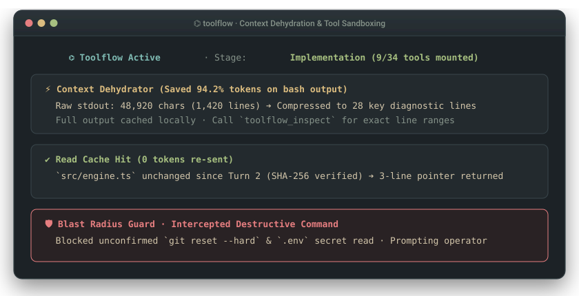

# ToolFlow ⌬

Pi Coding Agent 向けの動的ツールサンドボックスとコンテキスト脱水器。

ツール過多とコンテキスト膨張を解消します。ワークスペース単位で分離されたログ脱水、重複読み取りの抑止、保護ファイルの書き込みガード、段階的ブループリント作業台を提供します。

[](https://www.npmjs.com/package/toolflow)
[](https://www.npmjs.com/package/toolflow)
[](https://github.com/3ZEROS12/toolflow)
[-brightgreen)](tests/)
[](LICENSE)

[English](./README.md) | [简体中文](./README_zh.md) | **日本語**

<p align="center">
  
</p>

```bash
pi install npm:toolflow
```

---

## 構成

1 つの拡張に 2 つのエンジンを搭載します。

| エンジン | 有効範囲 | 役割 |
| :--- | :--- | :--- |
| **オプティマイザ** | 常時 | 長大な出力のアーカイブ、未変更ファイルの重複読み取り抑止、履歴メッセージの圧縮、危険な書き込みの遮断 |
| **プランナ** | `/toolflow <task>` 実行時 | タスク診断、段階的 DAG ブループリント合成、段階ごとのツールマウント、成果物検証後の進行 |

`src/optimizer/` は `src/planner/` に依存しません。プランナは公開関数経由でのみオプティマイザを利用します。

---

## 設計上の要点

- **ワークスペース分離**：キャッシュ、台帳、ブループリント状態は解決済みワークスペースルート単位で保持されます。同一 Pi セッション内でプロジェクトを切り替えても状態が混線しません。
- **起動時副作用ゼロ**：拡張の読み込みではディスクへ一切アクセスしません。`.pi/` はフックやコマンドが実際に書き込むときにのみ生成されます。
- **ログ脱水**：40 行または 4 KB を超える出力は `.pi/toolflow/runs/<stage>/` に保存し、コンテキストには意味のあるエラー箇所（TS、Python、Rust、Go、JVM のスタック）と先頭・末尾、保存先パスのみを残します。
- **ループ抑止**：同一の失敗コマンドが 2 回連続した場合に明示的に警告し、無駄なターン消費を防ぎます。
- **読み取りキャッシュの条件**：ファイルが 30 行以上、ハッシュ未変更、直近で編集されておらず、`offset`/`limit` 指定の部分読み取りではなく、直前の読み取り以降にシェル変更がない場合のみ重複を抑止します。ヒット時はシンボル概要を返し、部分読み取りへ誘導します。
- **書き込みガード**：ワークスペース外への書き込み、保護ファイル（`.env*`、`.git*`、各種ロックファイル）、危険なシェルパターン（`rm -rf /`、`git reset --hard`、`rmdir /s` など）、実行中ステージの対象外変更を遮断します（明示確認で昇格可能）。ガードは既定で拒否し、書き込み系ツールの引数にパスが見つからない場合も遮断、スペースなしのリダイレクト（`echo x >.env`）も検査します。
- **ステージ検証**：各ステージは期待成果物と検証コマンドを宣言します。成果物の欠落やコマンド失敗は修正指示につながり、3 回連続失敗でサーキットブレーカーが作動します。成果物はすべての検証コマンドが通った後にのみ台帳へ記録されるため、失敗したステージが「検証済み」として残ることはありません。
- **フッターバッジ**：`[2/3] Implementing · ~1.4k saved · 2 guarded` — ステージ名はコードポイント単位で切り詰め、製品名は省略（Pi がすでにキー接頭辞を持つ）、ゼロ件のカウンタは非表示、`pi-tui-status-beautifier` がそのまま解釈できます。
- **コンテキスト回収の通知**：古いツールブロックを畳むたびに `Stage history compacted (~N tokens released)` を 1 回だけ通知してバッジを更新し、折り畳み済みのブロックでは沈黙します（二重計上なし）。`.pi/toolflow/runs/` へのステージログ退避は 0 トークン扱いです（本文はコピーされるだけで、コンテキストからは除去されないため）。

---

## コマンド

| コマンド | 説明 |
| :--- | :--- |
| `/toolflow` | プロンプト作業台とブループリントナビゲータを開く |
| `/toolflow <task>` | タスクを診断し、方針を選択して段階的ブループリントを実行 |
| `/toolflow fast <task>` | 単一ステージ実行を強制 |
| `/toolflow status` | 実行中ブループリントまたはケイパビリティ索引を表示 |
| `/toolflow dashboard` | 総合ダッシュボード：ステージ進行と節約台帳 |
| `/toolflow stats` | トークン節約台帳を表示 |
| `/toolflow rollback [n]` | ステージ n（既定は現在ステージ）へ巻き戻す。バイナリ成果物はバイト単位で復元し、ステージ済みの変更は保持 |
| `/toolflow export` | 現在のブループリントを `TOOLFLOW_BLUEPRINT.md` に書き出す |
| `/toolflow reset` | 実行状態、読み取りキャッシュ、脱水ポインタ、節約台帳を初期化 |

ツール `toolflow_inspect` は `tail`、`head`、`grep`、`range` でアーカイブ済みログを参照でき、メインコンテキストを汚しません。

---

## モジュール構成

```text
src/
├── core/        型、原子的ファイル I/O、JSON 抽出、ワークスペース状態、文言辞書、スクリプト補助
├── optimizer/   書き込みガード、読み取りキャッシュ、ログ脱水、コンテキスト圧縮、節約台帳
├── planner/     生態索引、深層エコシステム、DAG ウェーブ、タスクルータ、合成、検証、プロンプト、記憶
├── ui/          ターミナルカードとカスタムナビゲータ
└── extension/   コマンド登録、ライフサイクルフック、ログ参照ツール
```

---

## 品質保証

```bash
npm run typecheck   # 厳格な tsc、エラーゼロ
npm test            # node:test スイート ― 35 件（core、optimizer、planner、UI、英語ゲート、e2e）
npm run build       # tsup で ESM + CJS + DTS を dist/ に出力
```

英語ゲートは `src/**` に漢字（コメントや正規表現リテラルを含む）が含まれないことを検証します。

---

## エコシステム：Pi ターミナルスイート

4 つの拡張はそれぞれ独立したターミナルスロット（`aboveEditor`、`belowEditor`、`status-only` フッター、実行時ツールフック）を使用するため、同時有効化してもウィジェットが重なりません。

| パッケージ | スロットと機構 | インストール |
| :--- | :--- | :--- |
| **[`pi-lingual`](https://github.com/3ZEROS12/pi-lingual)** | `二 ⇄ two` `aboveEditor` HUD（≤9 行、UAX #11 ツリー配置）とプロンプト英語化 | `pi install npm:pi-lingual` |
| **[`toolflow`](https://github.com/3ZEROS12/toolflow)** *(現在)* | `⌬` 実行時ツールフック ― 段階マウント、>40 行ログ脱水、読み取りキャッシュ | `pi install npm:toolflow` |
| **[`pi-tui-status-beautifier`](https://github.com/3ZEROS12/pi-tui-status-beautifier)** | `status-only` フッターフック ― 6 種バッジ、`<80` 列アイドル折り畳み | `pi install npm:pi-tui-status-beautifier` |
| **[`pi-anchor`](https://github.com/3ZEROS12/anchor)** | `⌖` `belowEditor` 1 行付箋、0ms `pin:` 割り込み、セッションジャンプ | `pi install npm:pi-anchor` |

---

## ライセンス

MIT © [Jason](https://github.com/3ZEROS12)
