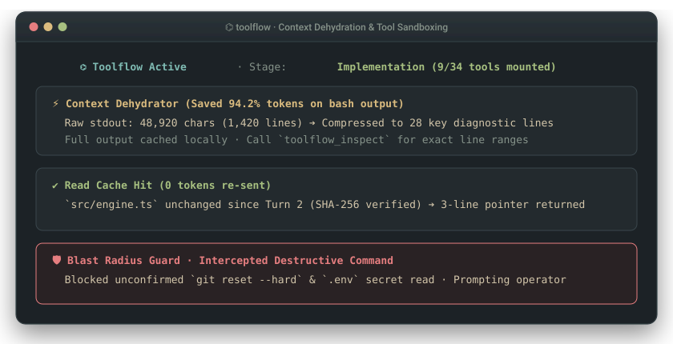

# ToolFlow ⌬

Pi Coding Agent 向けの動的ツールサンドボックス＆コンテキスト脱水エンジン。

ツール過多による誤呼び出しと長大なエラースタックによるコンテキスト圧迫を解消します。フェーズ別のオンデマンド機能マウント、40 行超のログ自動ディスク退避（トークン消費を 95% 削減）、機密設定ファイルの誤削除ガード、および即座に呼び出せるプロンプトワークベンチを内蔵しています。

[](https://www.npmjs.com/package/toolflow)
[](https://www.npmjs.com/package/toolflow)
[](https://github.com/3ZEROS12/toolflow/stargazers)
[](https://github.com/earendil-works/pi-coding-agent)
[-brightgreen)](tests/test_suite.ts)
[](LICENSE)

[English](./README.md) | **日本語** | [简体中文](./README_zh.md)

<p align="center">
  
</p>

```text
  ┌─ ツール過多 (40 以上のツールと MCP が同時にシステムプロンプトへ露出) ──────────────────┐
  │  read write edit bash browser_click mcp_query subagent_run git_reset ...             │
  │  [結果: スキーマ過多により、単純なヘルパー関数の作成指示でブラウザが起動してしまう]    │
  └──────────────────────────────────────────────────────────────────────────────────────┘
                                             │
                                             ▼
  ┌─ ToolFlow ⌬ フェーズ別サンドボックス (-95% コンテキスト消費削減) ─────────────────────┐
  │  Phase 1: Research  ❯ [read, grep, find, web_search]                                 │
  │  Phase 2: Implement ❯ [read, edit, write, bash] (40行超の冗長ログをディスクへ自動退避) │
  │  Phase 3: Review    ❯ [read, grep, bash (test-only)] (書き込みツールを実行時から剥奪) │
  └──────────────────────────────────────────────────────────────────────────────────────┘
```

## クイックスタート

Pi 内で直接インストールできます：

```bash
pi install npm:toolflow
```

インストール後すぐに動作します。いつでも `/toolflow` と入力して対話型プロンプトテレプロンプターを呼び出せます。

---

## コアバリュー：なぜ ToolFlow が必要なのか？

多数のツール、プラグイン、MCP サーバーを接続した AI コーディングエージェントでは、3 つの具体的な問題が発生します：

### 1. ツール定義の過多と誤呼び出し
40 以上のツール定義を同時にシステムプロンプトへ露出させると、LLM の注意が分散します。単純なユーティリティ関数を書いてほしいだけなのに、無関係なスキーマに引きずられてヘッドレスブラウザを起動したりデータベースへ接続したりする現象が起きます。
`toolflow` は**フェーズ別の機能マウント**を徹底します。基本ツール（`read`、`write`、`edit`、`bash`）は常時維持しつつ、重い外部 MCP、ブラウザ、サブエージェントは必要なフェーズでのみマウントします。

### 2. 長大なビルド・テストログによるコンテキスト飽和
ビルドや E2E テストを実行すると、500 行以上の生スタックトレースが出力されることがあります。これがそのままコンテキストウィンドウに流れ込むと、数ターンでトークン上限に達し、作業中の記憶が早期コンパクションで失われます。
`toolflow` は**リアルタイムのログ脱水（Log Dehydration）**を実行します。40 行を超える出力は自動的にディスク（`.pi/toolflow/runs/...`）へ退避され、モデルには終了コード、根本エラー要約、ファイルパスのみを渡すことで、**ログのトークン消費を 95% 削減**します。

### 3. プロンプトテンプレートの散逸と画面切り替え
よく使うプロンプトをメモ帳やブラウザから毎回コピー＆ペーストするのは、ターミナルでの集中を妨げます。
引数なしで `/toolflow` を実行すると**即座にプロンプトテレプロンプター**が立ち上がり、`[p]` キー 1 つで選択したテンプレートを入力欄へ挿入できます。

---

## 動作マトリクス

```text
  /toolflow <task> (サンドボックス実行の開始)   /toolflow (プロンプトテレプロンプターを起動)
```

| モード / シナリオ | ユーザーの操作 | ToolFlow の内部処理 | AI が受け取る内容 | 適した場面 |
| :--- | :--- | :--- | :--- | :--- |
| **フェーズ別マウント** | `/toolflow <task>` を実行 | 基本ツールは常駐、重い MCP はフェーズ別にマウント | 現在のフェーズに必要な最小限のツール一覧 | 複数フェーズにわたる開発タスク |
| **リアルタイムログ脱水** | 冗長なテストやビルドを実行 | 40 行超の出力をインターセプトし全文をディスクへ保存 | 終了コード・エラー要約・保存先パス（-95% トークン） | コンパイルエラー・テスト失敗解析 |
| **読み取り専用レビュー分離** | コードレビュー・検証フェーズへ移行 | 実行時から書き込み系ツールを物理的に除外 | 読み取り・検証用ツールのみ（誤編集を防止） | コードレビュー・受け入れ検証 |
| **即席テレプロンプター** | 引数なしで `/toolflow` を入力 | ローカル＆グローバルの `prompts/*.md` を自動索引 | `[p]` キーで選択したプロンプトを 1 秒で入力欄に挿入 | 定型プロンプトの再利用 |
| **完全復元（ゼロ残留）** | タスク完了または `/toolflow reset` | 起動時に取得した初期ツールスナップショットへ復元 | 元のクリーンなツール環境を 100% 復元 | タスク終了時・リセット時 |

---

## コマンド一覧

| コマンド | 説明 |
| :--- | :--- |
| `/toolflow` | プロンプトワークベンチ＆タスク初期化パネルを開く |
| `/toolflow <task>` | フェーズ別ツール制御付きでタスクを開始 |
| `/toolflow status` | 現在のフェーズパイプラインとマウント中ツールを表示（別名: `/sop`） |
| `/toolflow stats` | 累積トークン節約統計（脱水ログ数・キャッシュヒット数）を表示 |
| `/toolflow logs` | 直近に脱水されたログの全文を表示 |
| `/toolflow rollback` | 現在のフェーズ開始時のスナップショットへロールバック |
| `/toolflow reset` | 実行状態をクリアし、一時キャッシュを消去 |
| `/toolflow export` | フェーズ構成と設計判断を `BLUEPRINT.md` へエクスポート |

---

## 検証とテスト

```bash
npm test            # 統合リグレッションテストスイート (26 スイート通過)
```

---

## Ecosystem: Pi Terminal Suite

4 つの拡張機能はそれぞれ異なるターミナルスロット（`aboveEditor`、`belowEditor`、`status-only` フッター、実行時ツールフック）にマウントされるため、単体でも全種併用でも UI が干渉しません：

| パッケージ | ターミナル配置スロットと機構 | インストール |
| :--- | :--- | :--- |
| **[`pi-lingual`](https://github.com/3ZEROS12/pi-lingual)** | `二 ⇄ two` `aboveEditor` 二言語 HUD（最大 9 行・UAX #11 ツリーレイアウト）＆英語プロンプト変換（履歴トークン消費 0） | `pi install npm:pi-lingual` |
| **[`toolflow`](https://github.com/3ZEROS12/toolflow)** *(現在)* | `⌬` 実行時ツールフック —— フェーズ別 MCP マウント＆40 行超のログ自動ディスク退避（ログトークン 95% 削減） | `pi install npm:toolflow` |
| **[`pi-tui-status-beautifier`](https://github.com/3ZEROS12/pi-tui-status-beautifier)** | `status-only` フッターフック —— 6 種のバッジプリセット、`<80` 列での待機バッジ折りたたみ `(+N idle)`、描画ループ内ディスク I/O ゼロ | `pi install npm:pi-tui-status-beautifier` |
| **[`pi-anchor`](https://github.com/3ZEROS12/anchor)** | `⌖` `belowEditor` 1 行常駐付箋バー、0ms `pin:` インターセプト、ミニ進捗バー `[■■□□]` ＆ `↪` セッション復帰 | `pi install npm:pi-anchor` |

---

## ライセンス

MIT © [Jason](https://github.com/3ZEROS12)
