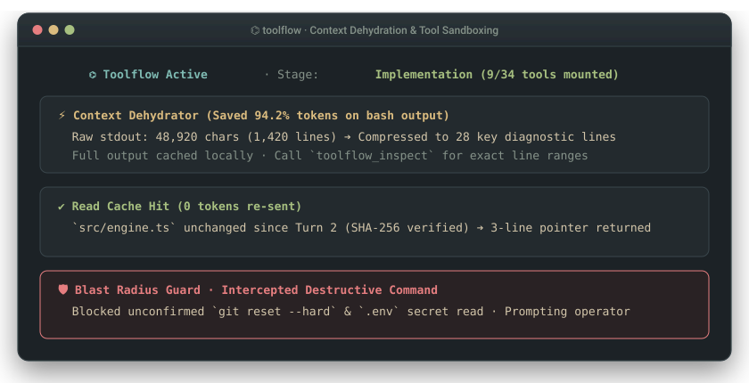

# ToolFlow ⌬

面向 Pi Coding Agent 的动态工具沙箱与上下文脱水器。

告别工具过载与上下文膨胀：工作区隔离的日志脱水、重复读取拦截、敏感文件写入护栏，以及分阶段蓝图工作台。

[](https://www.npmjs.com/package/toolflow)
[](https://www.npmjs.com/package/toolflow)
[](https://github.com/3ZEROS12/toolflow)
[-brightgreen)](tests/)
[](LICENSE)

[English](./README.md) | **简体中文** | [日本語](./README_ja.md)

<p align="center">
  
</p>

```bash
pi install npm:toolflow
```

---

## 功能构成

同一扩展内包含两套引擎：

| 引擎 | 生效时机 | 作用 |
| :--- | :--- | :--- |
| **优化器** | 始终生效 | 归档冗长输出、拦截未变更的重复读取、压缩历史消息、拦截危险写入 |
| **规划器** | `/toolflow <task>` 触发 | 任务诊断、分阶段 DAG 蓝图合成、按阶段挂载工具、产物校验后推进 |

`src/optimizer/` 不依赖 `src/planner/`；规划器只通过公开函数调用优化器能力。

---

## 工程要点

- **工作区隔离状态**：缓存、账本与蓝图状态全部按解析后的工作区根目录隔离。同一 Pi 会话内切换项目，不会串台阶段状态、读缓存或节省计数。
- **零冷启动副作用**：导入扩展不读写磁盘；只有钩子或命令真正写入时才创建 `.pi/`。
- **日志脱水**：超过 40 行或 4 KB 的输出归档到 `.pi/toolflow/runs/<stage>/`，上下文只保留语义错误峰值（TS、Python、Rust、Go、JVM 堆栈）、首尾片段与磁盘路径。
- **死循环拦截**：同一失败命令连续出现两次即明确提示，避免继续空耗对话轮次。
- **读缓存门禁**：仅当文件 ≥30 行、哈希未变、未被编辑、非 `offset`/`limit` 定向切片，且自上轮读取后无 shell 变更时，才拦截重复的完整读取；命中时返回符号大纲便于定向补读。
- **写入护栏**：拦截工作区外写入、敏感文件（`.env*`、`.git*`、各类锁文件）、危险 shell 模式（`rm -rf /`、`git reset --hard`、`rmdir /s` 等），以及活动阶段内超出目标范围的改动（可显式确认升级）。
- **阶段校验**：每阶段声明期望产物与校验命令；产物缺失或命令失败会触发修复提示，连续三次失败进入熔断暂停。

---

## 命令

| 命令 | 说明 |
| :--- | :--- |
| `/toolflow` | 打开提示词工作台与蓝图导航器 |
| `/toolflow <task>` | 诊断任务、选择方案并执行分阶段蓝图 |
| `/toolflow fast <task>` | 强制单阶段执行 |
| `/toolflow status` | 查看当前蓝图或能力索引 |
| `/toolflow stats` | 查看 Token 节省账本 |
| `/toolflow rollback [n]` | 回滚到第 n 阶段（默认当前阶段） |
| `/toolflow export` | 导出当前蓝图到 `TOOLFLOW_BLUEPRINT.md` |
| `/toolflow reset` | 清理活动状态、读缓存与脱水指针 |

工具：`toolflow_inspect` 可按 `tail`、`head`、`grep`、`range` 模式查看归档日志，不污染主上下文。

---

## 模块结构

```text
src/
├── core/        类型、原子文件读写、JSON 提取、工作区状态、文案字典、脚本辅助
├── optimizer/   写入护栏、读缓存、日志脱水、上下文压缩、节省账本
├── planner/     生态索引、深度生态、DAG 分波、任务路由、蓝图合成、校验器、提示词、记忆
├── ui/          终端卡片与自定义导航组件
└── extension/   命令注册、生命周期钩子、日志查看工具
```

---

## 质量保障

```bash
npm run typecheck   # 严格 tsc，零错误
npm test            # node:test 套件 —— 35 项（core、optimizer、planner、UI、英文门禁、e2e）
npm run build       # tsup 产出 ESM + CJS + DTS 到 dist/
```

英文门禁会断言 `src/**` 中不含任何汉字（包括注释与正则字面量）。

---

## 生态：Pi 终端套件

四个扩展各占独立终端槽位（`aboveEditor`、`belowEditor`、`status-only` 页脚、运行时工具钩子），可同时启用且零控件重叠：

| 包 | 终端槽位与机制 | 安装 |
| :--- | :--- | :--- |
| **[`pi-lingual`](https://github.com/3ZEROS12/pi-lingual)** | `二 ⇄ two` `aboveEditor` HUD（≤9 行，UAX #11 树形布局）与提示词英文化转换 | `pi install npm:pi-lingual` |
| **[`toolflow`](https://github.com/3ZEROS12/toolflow)** *(当前)* | `⌬` 运行时工具钩子 —— 阶段化挂载、>40 行日志脱水、读缓存 | `pi install npm:toolflow` |
| **[`pi-tui-status-beautifier`](https://github.com/3ZEROS12/pi-tui-status-beautifier)** | `status-only` 页脚钩子 —— 6 套徽标预设，`<80` 列空闲折叠 | `pi install npm:pi-tui-status-beautifier` |
| **[`pi-anchor`](https://github.com/3ZEROS12/anchor)** | `⌖` `belowEditor` 单行便签条、0ms `pin:` 拦截、会话跳转 | `pi install npm:pi-anchor` |

---

## 许可证

MIT © [Jason](https://github.com/3ZEROS12)
